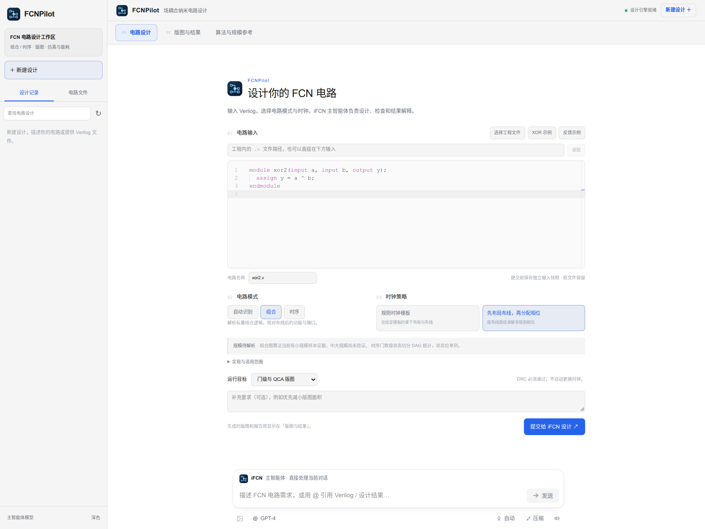

# FCNPilot

[简体中文](README.md) | **English**

An AI-assisted workspace for field-coupled nanocomputing (FCN) circuit design. Work with the iFCN agent to turn Verilog into circuit layouts, QCA device layouts, simulation results, and energy estimates.



## Features

- **Conversational design**: describe a circuit or provide Verilog, edit source files, and submit designs in your browser.
- **Full design pipeline**: Verilog → logic DAG → placement and routing → QCA layout → simulation and energy estimation.
- **Visual results**: preview gate layouts and QCA layouts; inspect metrics and download artifacts.

Supports a limited Verilog subset. Combinational circuits can use the full pipeline; sequential support is experimental and produces candidate QCA layouts by default. Simulation and energy results are numerical model estimates.

## Quick start

Recommended: **Ubuntu 24.04 / WSL2**, with **Node.js ≥22.19** and **Python 3.12** installed. Download the repository, then run from its root:

```bash
sudo apt install build-essential cmake pkg-config graphviz libgraphviz-dev \
  libboost-dev python3-dev python3-venv yosys
./setup.sh
./start.sh
```

Open **<http://127.0.0.1:30211>**:

1. Click **启用 iFCN 引擎** (Enable iFCN engine) and confirm trust in the project.
2. Open **主智能体模型** (Agent model) at the bottom left, add an API key or sign in to your model provider, and select a model.
3. Click **XOR 示例** (XOR example), then **提交给 iFCN 设计** (Submit to iFCN). View the output under **版图与结果** (Layouts & results).

Local checks: `./verify.sh` (no LLM API calls).

## Project structure

- [apps/web](apps/web/): Web workspace
- [engine](engine/): circuit design and analysis engine
- [integrations/pi](integrations/pi/): agent tools and examples
- [paper](paper/) / [experiments](experiments/): paper and reproducibility materials

## License

Released under the [MIT License](LICENSE). Built on [iFCN](https://github.com/li-yangshuai/iFCN) and [Pi Web UI](apps/web/LICENSE). Third-party components retain their own licenses and attribution.
