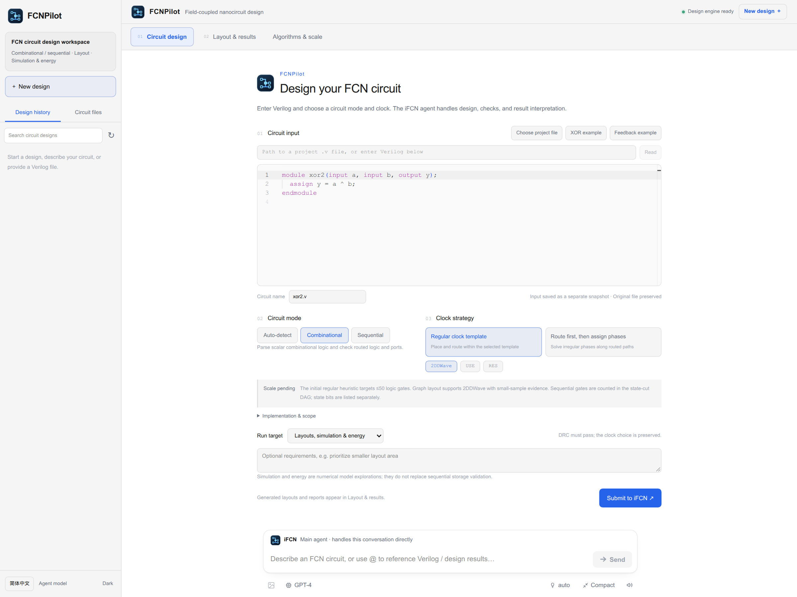
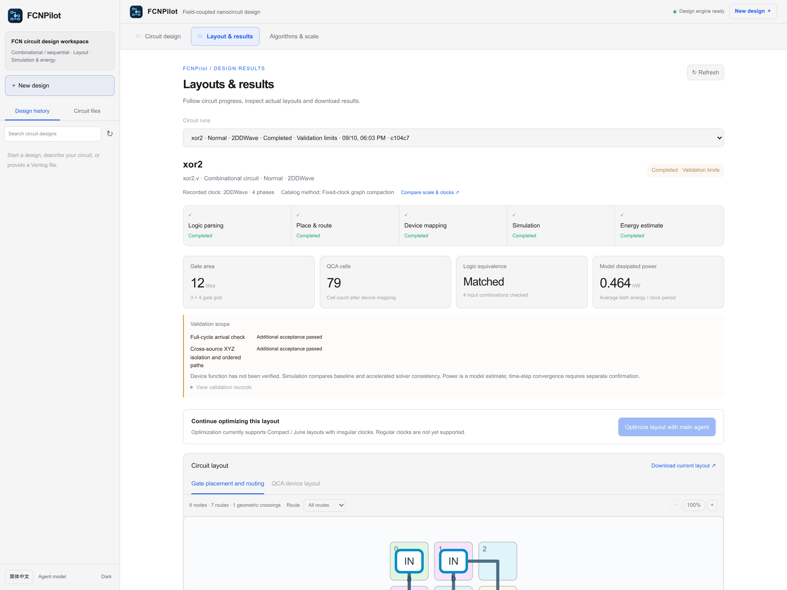
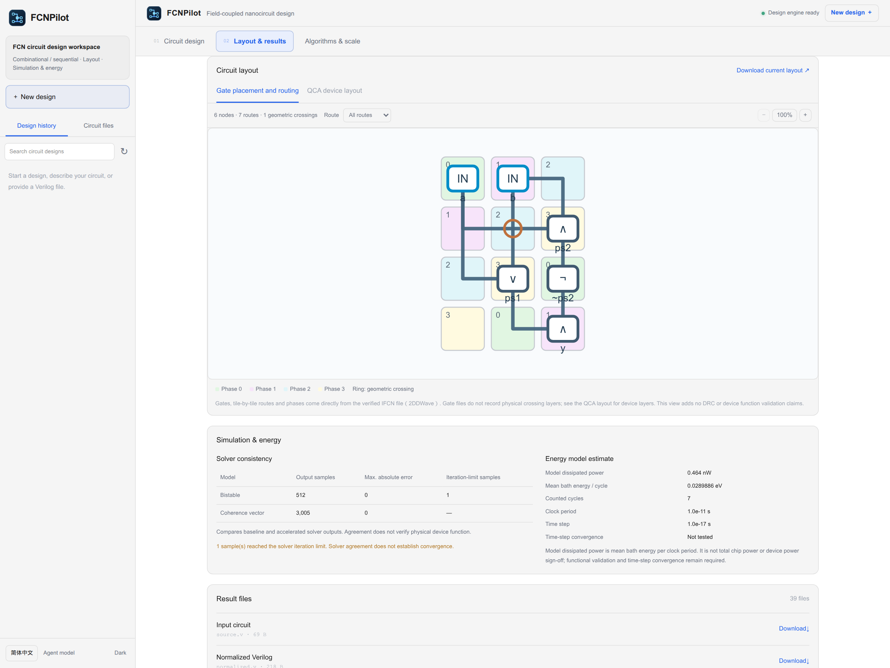
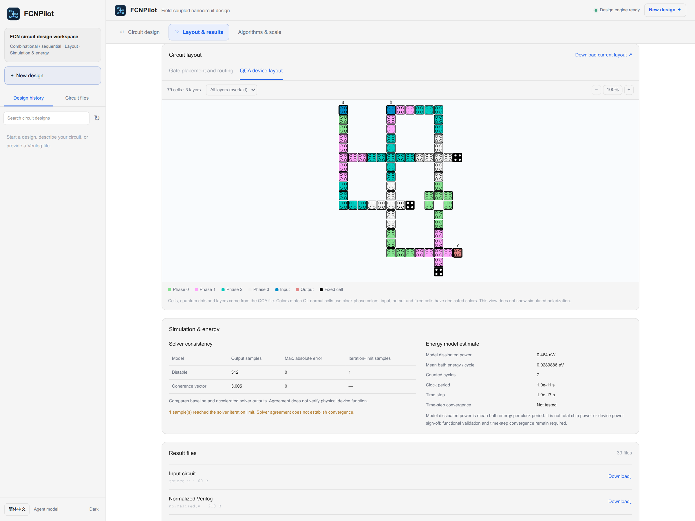
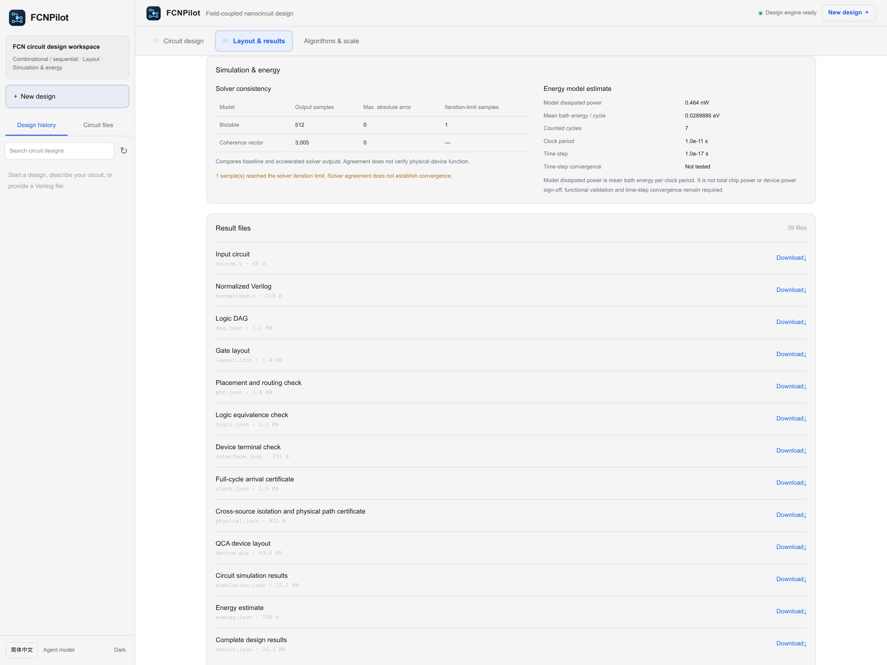

# FCNPilot

[简体中文](README.md) | **English**

An AI-assisted workspace for field-coupled nanocomputing (FCN) circuit design. Work with the iFCN agent to turn Verilog into circuit layouts, QCA device layouts, simulation results, and energy estimates.



## Features

- **Conversational design**: describe a circuit or provide Verilog, edit source files, and submit designs in your browser.
- **Full design pipeline**: Verilog → logic DAG → placement and routing → QCA layout → simulation and energy estimation.
- **Visual results**: preview gate layouts and QCA layouts; inspect metrics and download artifacts.
- **English and Chinese**: switch with English / 简体中文 in the sidebar; your choice persists after refresh.

Supports a limited Verilog subset. Combinational circuits can use the full pipeline; sequential support is experimental and produces candidate QCA layouts by default. Simulation and energy results are numerical model estimates.

## Quick start

Recommended: **Ubuntu 24.04 / WSL2**, with **Node.js ≥22.19** and **Python 3.12** installed. Download the repository, then run from its root:

```bash
sudo apt install build-essential cmake pkg-config graphviz libgraphviz-dev \
  libboost-dev python3-dev python3-venv yosys
./setup.sh
./start.sh
```

Open **<http://127.0.0.1:30211>**:

1. Click **Enable iFCN engine** and confirm trust in the project.
2. Open **Agent model** at the bottom left, add an API key or sign in to your model provider, and select a model.
3. Click **XOR example**, then **Submit to iFCN**. View the output under **Layout & results**.

Local checks: `./verify.sh` (no LLM API calls).

## XOR walkthrough

The bundled [xor2.v](integrations/pi/examples/xor2.v) was run through the same Pi tools used by the Web workspace: parsing, placement and routing, device mapping, simulation, and energy estimation. Settings: **2DDWave, bistable + coherence, standard energy profile**.

Reproduce with `node integrations/pi/smoke.mjs`; no LLM API is needed. [Recorded results](docs/examples/xor2-results.json): **12 tiles (3×4), 79 QCA cells, logic equivalence for all 4 input combinations, and approximately 0.464 nW model dissipated power**.

**Pipeline status and validation**



**Generated gate layout**



**Generated QCA device layout**



**Simulation and energy**



Both models report zero maximum error between baseline and accelerated implementations. One sample reached the iteration limit, so the run retains its **Completed · Validation limits** status. Solver agreement does not establish device function; time-step convergence has not been tested.

## Paper layout modes

This branch provides `multi_agent` for complete-layout search and `clock_repair` for local clock repair. The modes run separately and use rule-based selection by default. See the [setup and usage notes](docs/paper-layout.md) and the [Table 1 benchmark layouts](https://github.com/li-yangshuai/FCNPilot/tree/paper-data/DataBase), which include both `.ifcn` and `.qca` files.

## Project structure

- [apps/web](apps/web/): Web workspace
- [engine](engine/): circuit design and analysis engine
- [integrations/pi](integrations/pi/): agent tools and examples
- [paper](paper/) / [experiments](experiments/): paper and reproducibility materials

## License

Released under the [MIT License](LICENSE). Built on [iFCN](https://github.com/li-yangshuai/iFCN) and [Pi Web UI](apps/web/LICENSE). Third-party components retain their own licenses and attribution.
