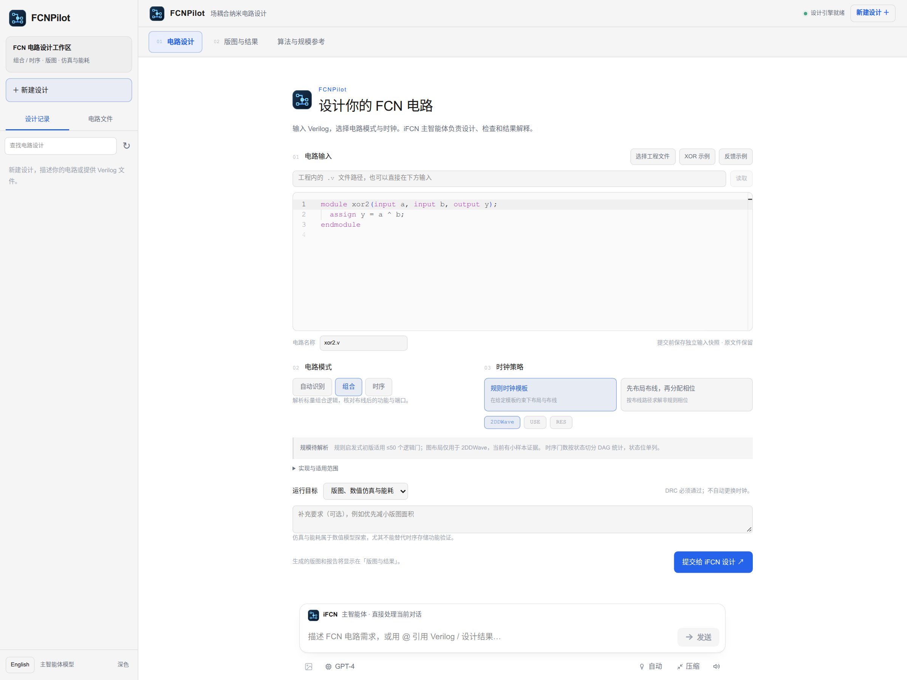
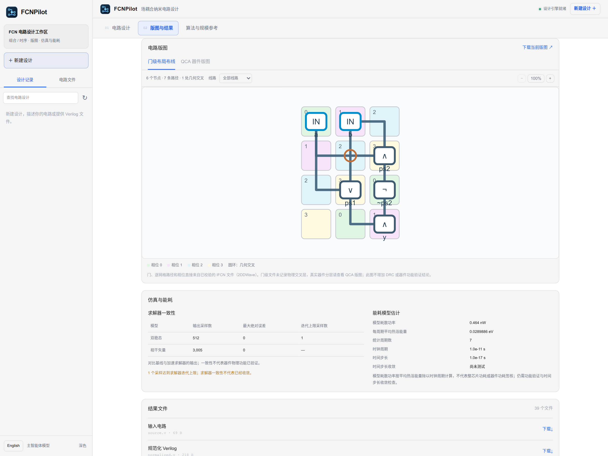
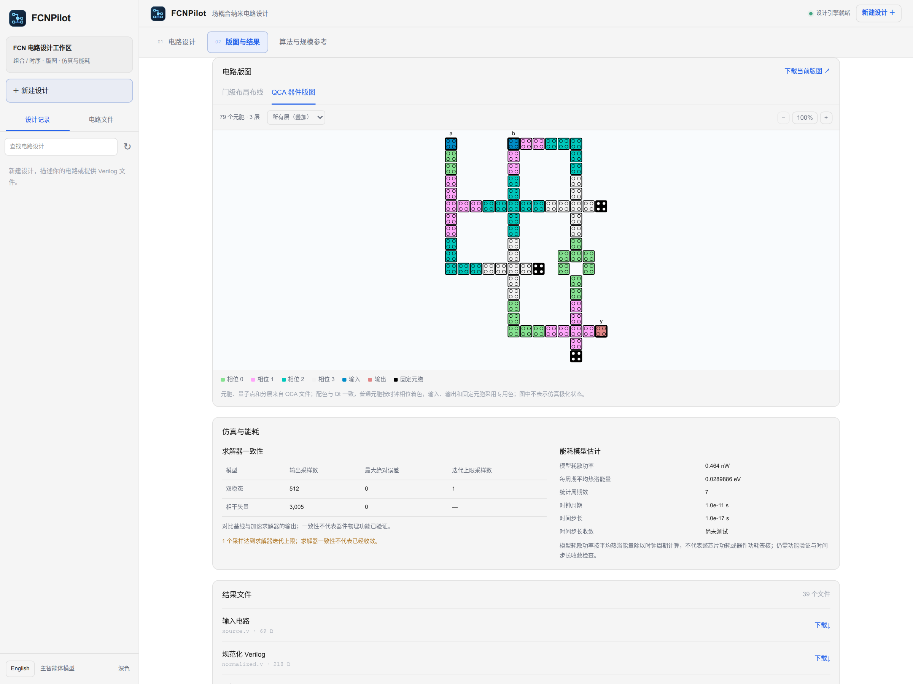
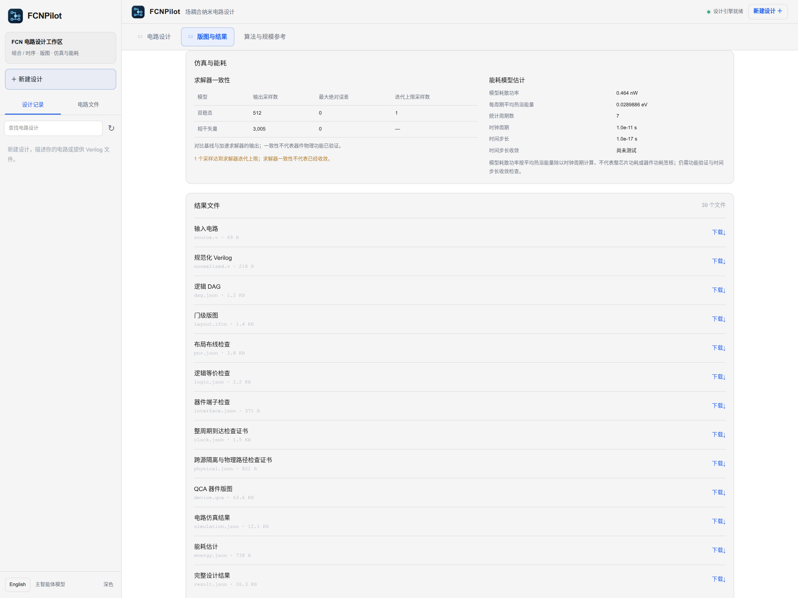

# FCNPilot

**简体中文** | [English](README.en.md)

面向场耦合纳米电路（FCN）的 AI 设计工作台。与 iFCN 智能体对话，从 Verilog 出发，完成电路布局、QCA 器件映射、仿真与能耗估计。



## 功能

- **对话式设计**：描述需求或提供 Verilog，在浏览器中编辑电路并提交设计。
- **完整设计流程**：Verilog → 逻辑 DAG → 布局布线 → QCA 版图 → 仿真与能耗估计。
- **结果可视化**：预览门级布局与 QCA 版图，查看指标并下载结果。
- **中英切换**：在侧栏点击 English / 简体中文，刷新后保留语言选择。

当前支持受限 Verilog 子集，组合电路可运行完整流程；时序电路为实验性支持，默认生成 QCA 候选版图。仿真与能耗为数值模型估计。

## 快速开始

推荐 **Ubuntu 24.04 / WSL2**，先安装 **Node.js ≥22.19** 和 **Python 3.12**。下载仓库后，在仓库根目录运行：

```bash
sudo apt install build-essential cmake pkg-config graphviz libgraphviz-dev \
  libboost-dev python3-dev python3-venv yosys
./setup.sh
./start.sh
```

打开 **<http://127.0.0.1:30211>**：

1. 点击「启用 iFCN 引擎」，按提示确认信任当前工程。
2. 在左下角「主智能体模型」中配置 API Key 或登录模型账户，并选择模型。
3. 点击「XOR 示例」填入电路，再点击「提交给 iFCN 设计」，随后在「版图与结果」中查看输出。

本地验证：`./verify.sh`（不调用 LLM API）。

## XOR 全流程示例

使用内置 [xor2.v](integrations/pi/examples/xor2.v)，通过与网页相同的 Pi 工具链，完成解析、布局布线、器件映射、仿真和能耗估计。配置为 **2DDWave、bistable + coherence、standard 能耗配置**。

复现：`node integrations/pi/smoke.mjs`，无需 LLM API。[本次测试记录](docs/examples/xor2-results.json)：**12 tiles（3×4）、79 个 QCA 元胞、4/4 组输入逻辑等价、模型耗散功率约 0.464 nW**。

**流程状态与验证结果**


**生成的门级布局布线**



**生成的 QCA 器件版图**



**仿真与能耗**



两种模型的基线与加速实现最大误差均为 0；其中 1 个采样触及迭代上限，因此结果保留「已完成 · 有验证限制」状态。实现一致性不代表器件功能验证，时间步长收敛尚未验证。

## 项目结构

- [apps/web](apps/web/)：Web 工作台
- [engine](engine/)：电路设计与分析引擎
- [integrations/pi](integrations/pi/)：智能体工具与示例
- [paper](paper/) / [experiments](experiments/)：论文与复现实验

## 许可

采用 [MIT 许可证](LICENSE)。基于 [iFCN](https://github.com/li-yangshuai/iFCN) 与 [Pi Web UI](apps/web/LICENSE) 构建，第三方组件保留各自的许可与署名。
